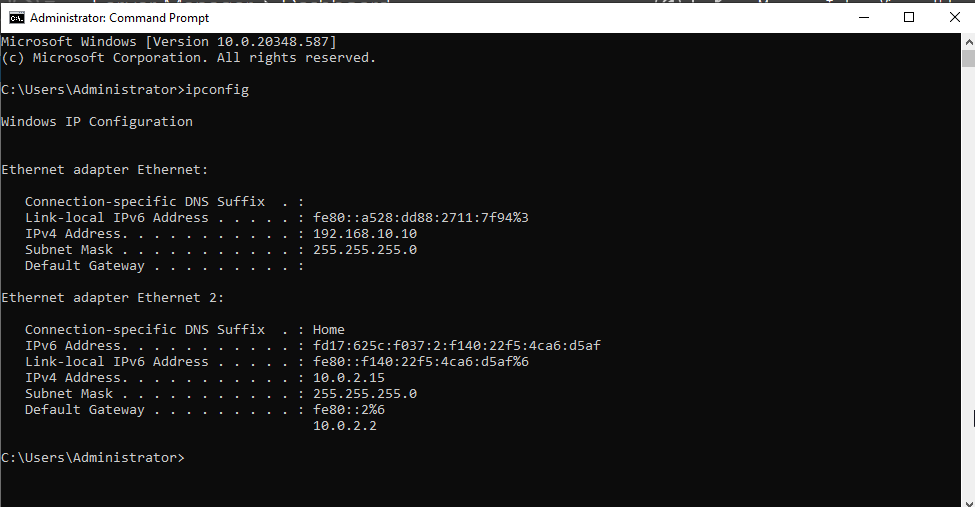
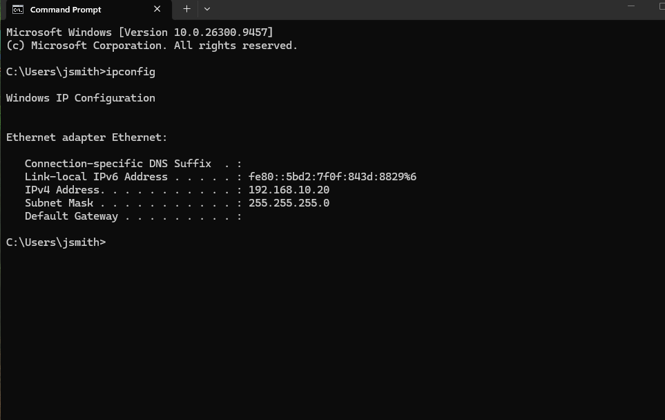
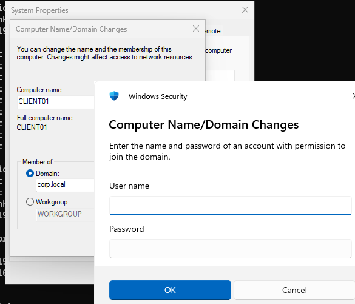
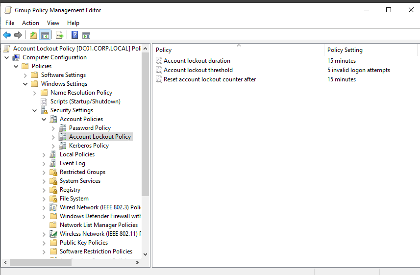
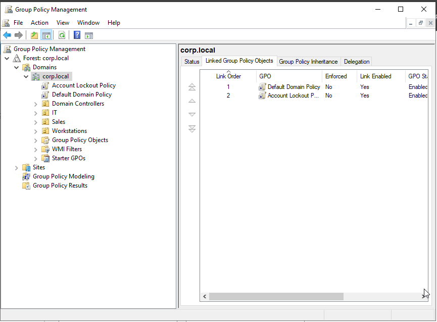
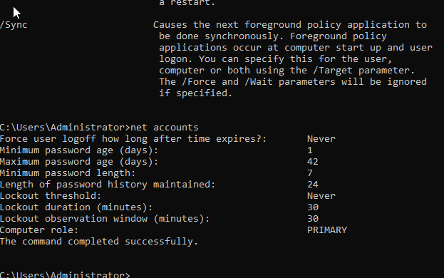
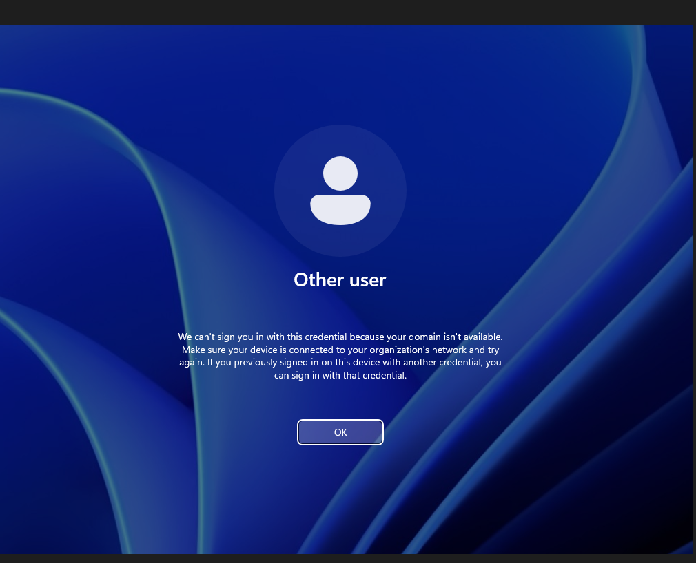
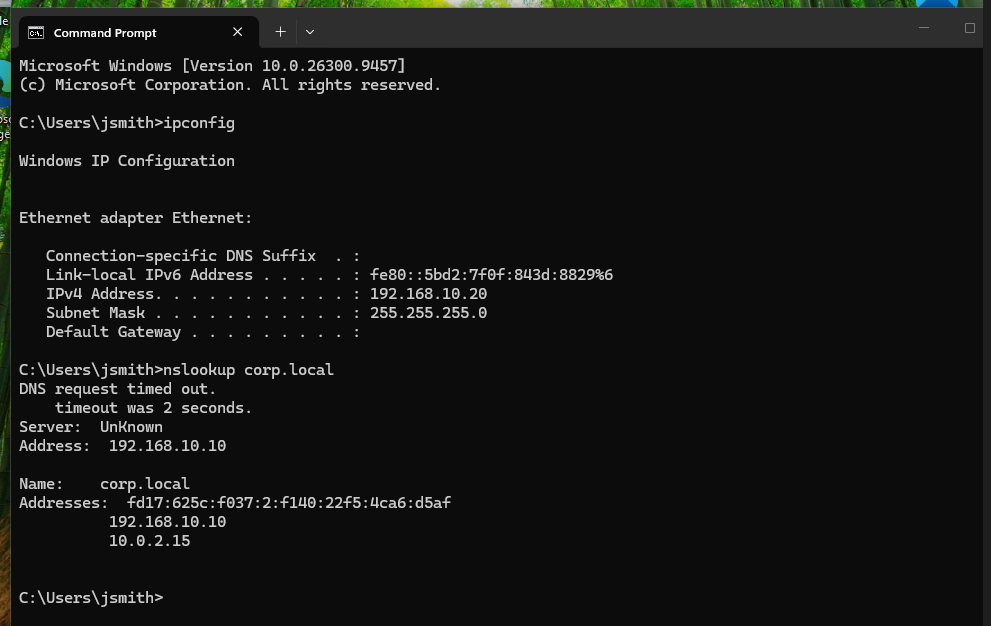
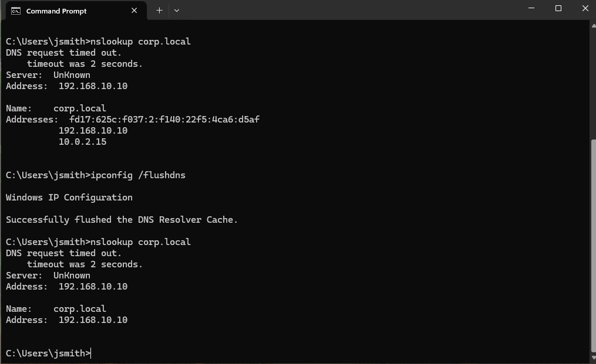
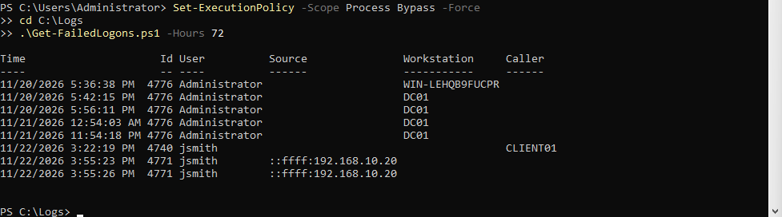

# Active Directory Security Home Lab

A small Windows domain built in VirtualBox to practice Active Directory administration and security monitoring: a domain-joined Windows 11 client, an account lockout policy enforced through Group Policy, and a PowerShell script that reports failed logons and lockouts from the domain controller's Security log.

**Skills practiced:** Active Directory and DNS, Group Policy, network troubleshooting, Windows event auditing, PowerShell.


## Lab environment

| Item | Details |
| --- | --- |
| Hypervisor | Oracle VirtualBox on a Windows laptop (16 GB RAM) |
| DC01 | Windows Server 2022 Standard Evaluation, domain controller and DNS server for `corp.local` |
| CLIENT01 | Windows 11 Pro, domain-joined workstation |
| Lab network | VirtualBox Internal Network, 192.168.10.0/24 |
| DC01 address | 192.168.10.10 (static); also has a NAT adapter (10.0.2.15) for internet |
| CLIENT01 address | 192.168.10.20 (static), DNS pointed at DC01 |
| Test accounts | `jsmith` and `mjones` (standard domain users) |

The domain has OUs for IT, Sales, and Workstations.

## What I built

1. **Domain-joined client.** Created CLIENT01, set a static IP and DNS, verified with `ping` and `nslookup`, joined `corp.local`, and moved it into the Workstations OU.
2. **Account lockout policy.** A GPO linked at the domain level: 5 invalid attempts, 15-minute lockout, 15-minute reset.
3. **Lockout test.** Entered wrong passwords for `CORP\jsmith` from CLIENT01 and confirmed on DC01 (`BadLogonCount 5`, `LockedOut True`).
4. **Failed-logon reporting.** Enabled failure auditing on the domain controller and wrote a PowerShell script that lists failed logons and lockouts.

## Screenshots

### Build and join





<!-- TODO add: screenshots/01-build-and-join/welcome-to-domain.png, whoami.png, client01-in-workstations-ou.png -->

### Lockout policy



Before the fix: the Default Domain Policy was at link order 1, so it overrode my GPO, and `net accounts` still showed a threshold of Never.




<!-- TODO add: screenshots/02-lockout-policy/link-order-after.png, net-accounts-after.png (threshold 5) -->

### Testing and the DNS fix

<!-- TODO add: screenshots/03-testing-and-dns-fix/locked-out-message.png, jsmith-locked-aduc.png, get-aduser-result.png -->

CLIENT01 reported that the domain wasn't available. `nslookup corp.local` returned DC01's NAT and IPv6 addresses along with its internal one, and CLIENT01 couldn't reach the NAT address.





### Failed-logon script



## Problems I solved

| Problem | Cause | Fix |
| --- | --- | --- |
| DC01 slow and laggy | Memory pressure and Windows virtualization features competing with VirtualBox | Closed other apps, reviewed VM RAM and Hyper-V settings |
| Windows 11 setup blocked | TPM 2.0 and Secure Boot checks | LabConfig registry bypass in setup (lab VM only) |
| Lockout policy not applying | Default Domain Policy had higher link order | Moved the lockout GPO to link order 1 |
| `gpupdate` did nothing | Typed a backslash instead of a forward slash | `gpupdate /force` |
| Domain "isn't available" at sign-in | DC01's NAT adapter registered extra addresses in DNS | Stopped DNS registration on that adapter and cleaned up the records |
| Failed logons missing from the log | Failure auditing not enabled on the DC | Enabled Success and Failure for Credential Validation and Kerberos Authentication Service |
| User column showed the authentication package | First version of the script read the first event field instead of the named one | Parse event data by field name |

## The script

[`scripts/Get-FailedLogons.ps1`](scripts/Get-FailedLogons.ps1) reads Security events from the last N hours and prints time, event ID, user, source IP, workstation, and caller computer. It can export a CSV.

```powershell
# Run in an elevated PowerShell session on the domain controller
.\Get-FailedLogons.ps1 -Hours 24
.\Get-FailedLogons.ps1 -Hours 48 -OutFile C:\FailedLogons.csv
```

**Prerequisite:** failure auditing on the domain controller (Default Domain Controllers Policy > Advanced Audit Policy Configuration > Account Logon): Audit Credential Validation and Audit Kerberos Authentication Service, both Success and Failure.

| Event ID | Logged on | Meaning |
| --- | --- | --- |
| 4625 | The computer where the logon was attempted | Failed logon (on a domain, this is CLIENT01, not DC01) |
| 4771 | Domain controller | Kerberos pre-authentication failed (bad password) |
| 4776 | Domain controller | NTLM credential validation |
| 4740 | Domain controller | Account locked out |

## Splunk SIEM Monitoring

Forwarded the domain controller's Security log to Splunk Enterprise so authentication events can be searched, charted, and alerted on.

### Setup

| Component | Details |
| --- | --- |
| Splunk Enterprise | Installed on the host laptop; receives data on port 9997, search UI on 8000 |
| Splunk Universal Forwarder | Installed on DC01, sends the Security event log |
| Index | `ad_lab` |
| Connection | DC01's NAT adapter to the host at `10.0.2.2:9997` |

Forwarder input on DC01 (`inputs.conf`):

```
[WinEventLog://Security]
index = ad_lab
disabled = 0
```

### Dashboard: AD Authentication Monitoring

- Repeated failed logons by source
- Account lockouts (locked user and caller computer)
- Failed logons over time
- Account changes (create, enable, password reset, disable, delete)

### Alerts

- **Repeated Failed Logons:** fires when one source produces 5 or more Kerberos pre-authentication failures (Event 4771) within 15 minutes. Runs every 5 minutes.
- **Account Lockout:** fires on any Event 4740.

Searches and alert settings are in [`splunk/detections.md`](splunk/detections.md).

### Testing

Entered wrong passwords for `CORP\jsmith` from CLIENT01 until the lockout policy locked the account, then confirmed the 4771 failures and the 4740 lockout appeared in Splunk and on the dashboard. Created, reset, disabled, and deleted a test account to populate the account changes panel.

### Screenshots

**Dashboard**


**Failed logon (4771) and lockout (4740) events in Splunk**


**Account changes (create, enable, password reset, disable, delete)**


**Triggered alerts**


**Audit policy: User Account Management set to Success and Failure in Group Policy**


### Issues and fixes

| Problem | Cause | Fix |
| --- | --- | --- |
| Searches for "last 15 minutes" returned nothing | DC01's clock was hours off the host, so events were timestamped in the future | Synced DC01's time with `w32tm` and confirmed UTC time matched on both machines |
| Account locked but no lockout (4740) event in Splunk | `auditpol` showed User Account Management set to No Auditing, so DC01 did not record the event | Enabled Success and Failure auditing for that subcategory with `auditpol`, then set it in Group Policy so it persists |
| First forwarded events never appeared | Forwarder started sending before the `ad_lab` index existed, so Splunk dropped them | Created the index first, then generated fresh events |
| No data after DC01 froze and was reset | Needed to confirm the forwarder and connection came back | Checked `Get-Service SplunkForwarder`, `Test-NetConnection 10.0.2.2 -Port 9997`, and the latest event time in Splunk |

### Detections

| Detection | Event |
| --- | --- |
| Repeated failed logons | 4771 |
| Account lockout | 4740 |
| Account changes | 4720, 4722, 4724, 4725, 4726 |

## Takeaways

- Account lockout policy only takes effect at the domain level, and GPO link order decides which policy wins.
- Lockouts are enforced by the domain controller, so failed attempts that never reach it do not count.
- A domain controller only records what it is told to audit, so detection depends on turning on failure auditing first.
- A brute-force attempt looks like repeated 4771 events for one account from one source, ending in a 4740 lockout.

## Next steps

Schedule the script to run daily and flag any account with several failures in a short window.

## Notes

This is a lab built on evaluation licenses and is not a production design. The PowerShell script was developed with AI assistance (Claude).

*Made by Nicholas Convento*
